

<picture>
  <source media="(prefers-color-scheme: dark)" srcset="media/logo/majlis-logo-on-dark.png">
  <source media="(prefers-color-scheme: light)" srcset="media/logo/majlis-logo-on-light.png">
  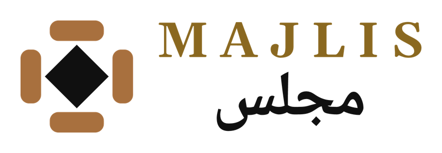
</picture>

### Your table. Your people. · طاولتك. ناسك.

**An Arabic-first social card game platform for iOS and Android.**
Sit down with friends, family or new players for Tarneeb, Trix and 400 (أربعمية),
online or offline, on a table that feels like the real thing.

[Website](https://majlis-game.com) · [Features](#features) · [Status](#status) · [Contact](#contact)

---

> **This repository is a showcase.** It holds screenshots and short clips of Majlis.

## In motion

<table>
  <tr>
    <td align="center">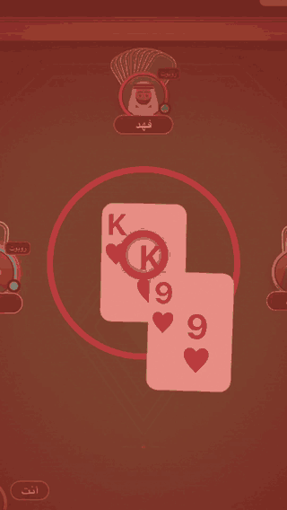 The King of Hearts moment</td>
    <td align="center">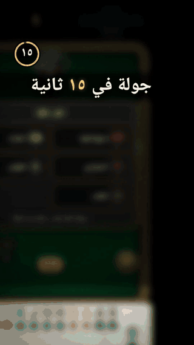 A whole round, sped up</td>
  </tr>
  <tr>
    <td align="center">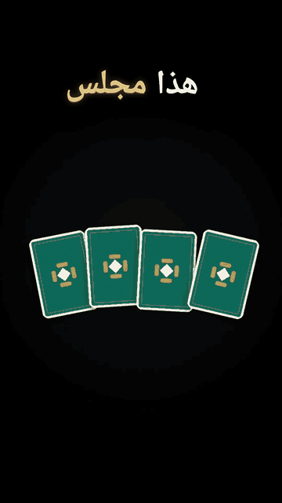 App tour</td>
    <td align="center">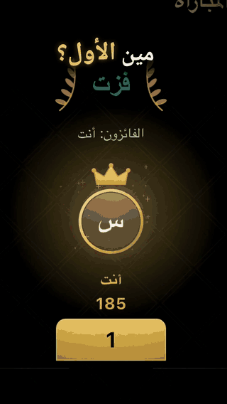 Last cards and the podium</td>
  </tr>
</table>

Full-quality vertical clips: <a href="media/video/app-tour.mp4">app tour (mp4)</a> · <a href="media/video/king-of-hearts.mp4">King of Hearts (mp4)</a>

## Screenshots

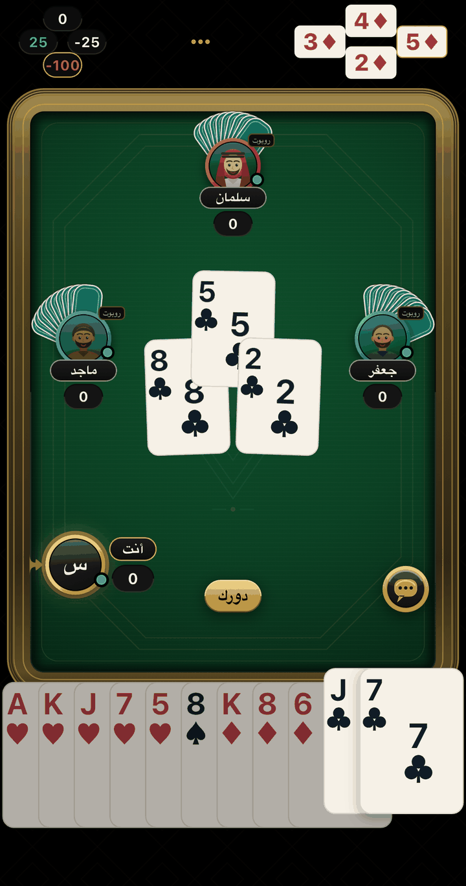&nbsp;
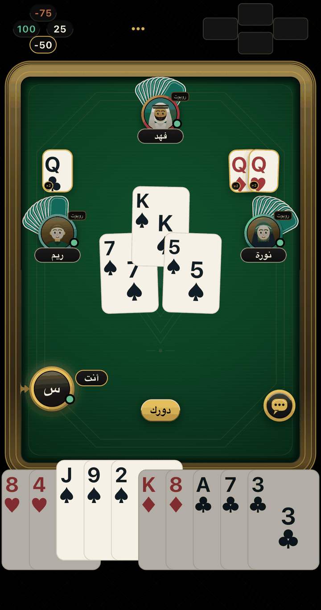&nbsp;
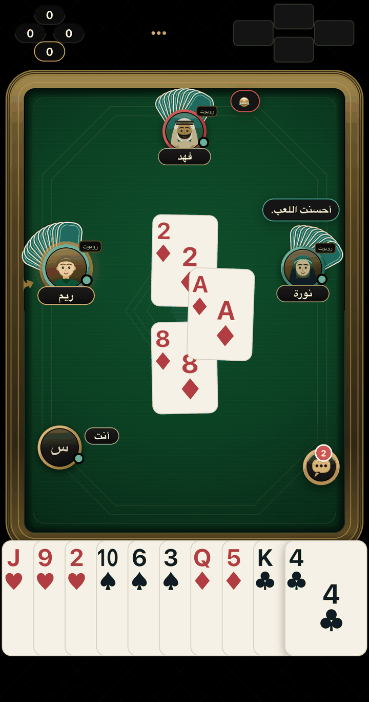&nbsp;
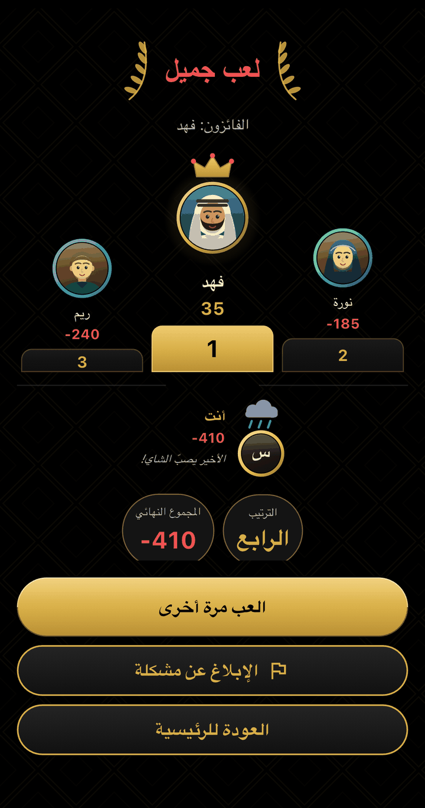

<b>App tour, one screen at a time</b>

 

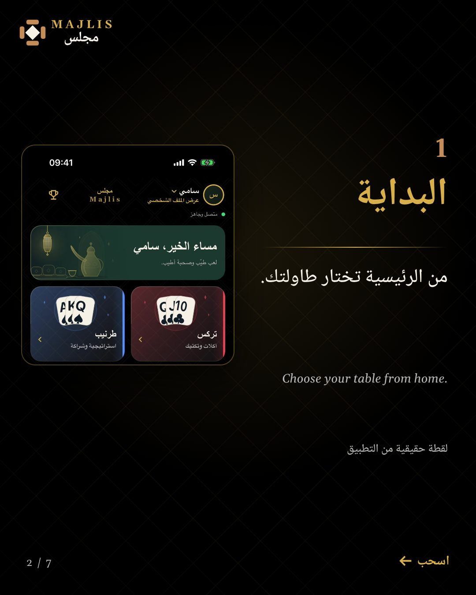
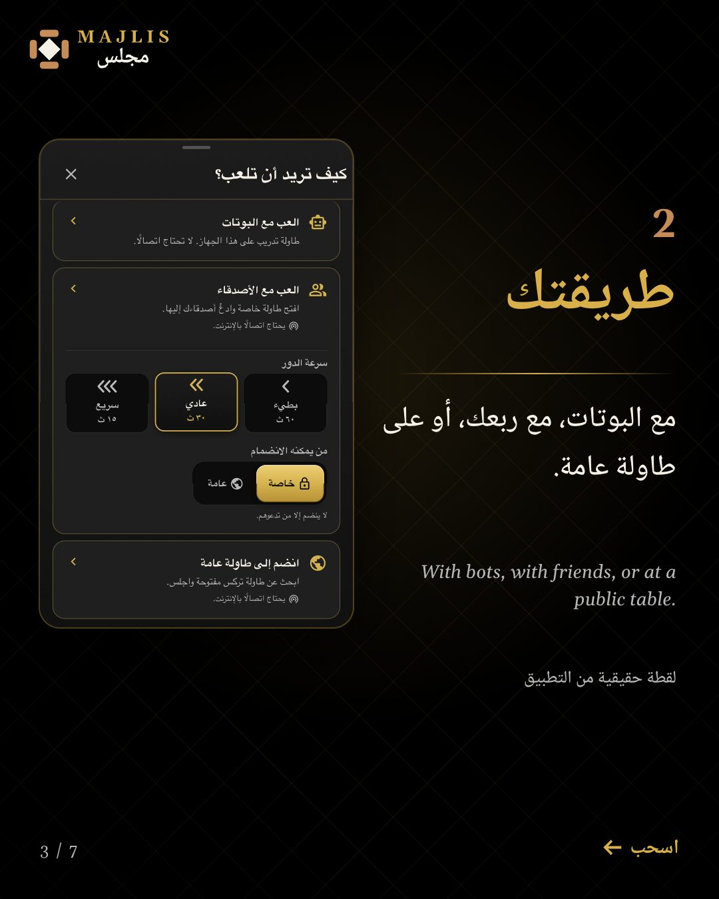
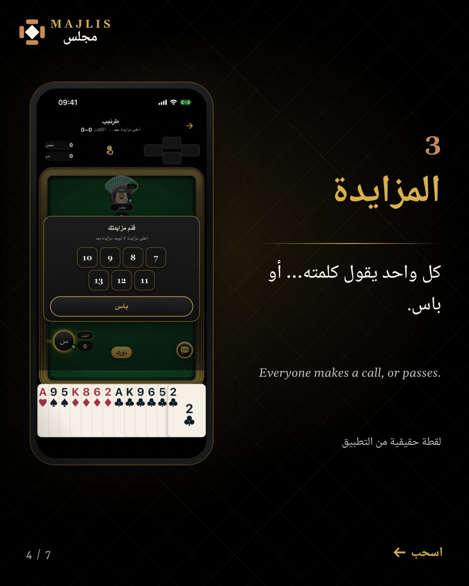
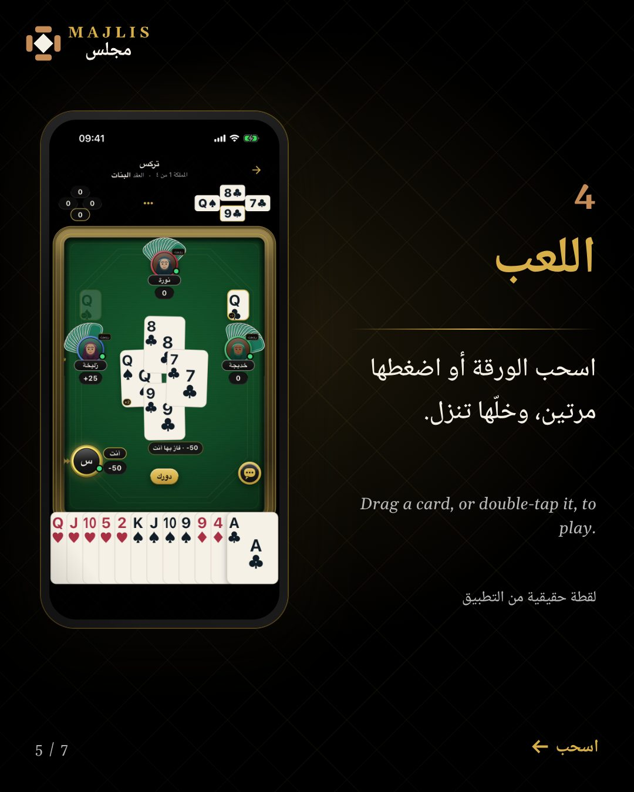
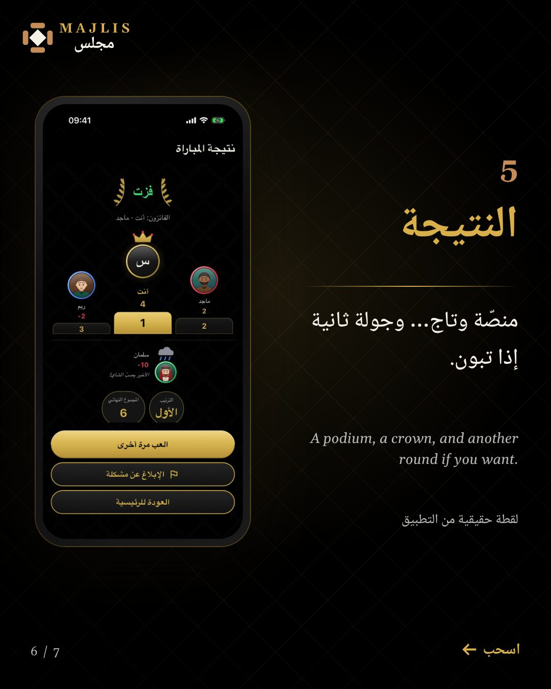
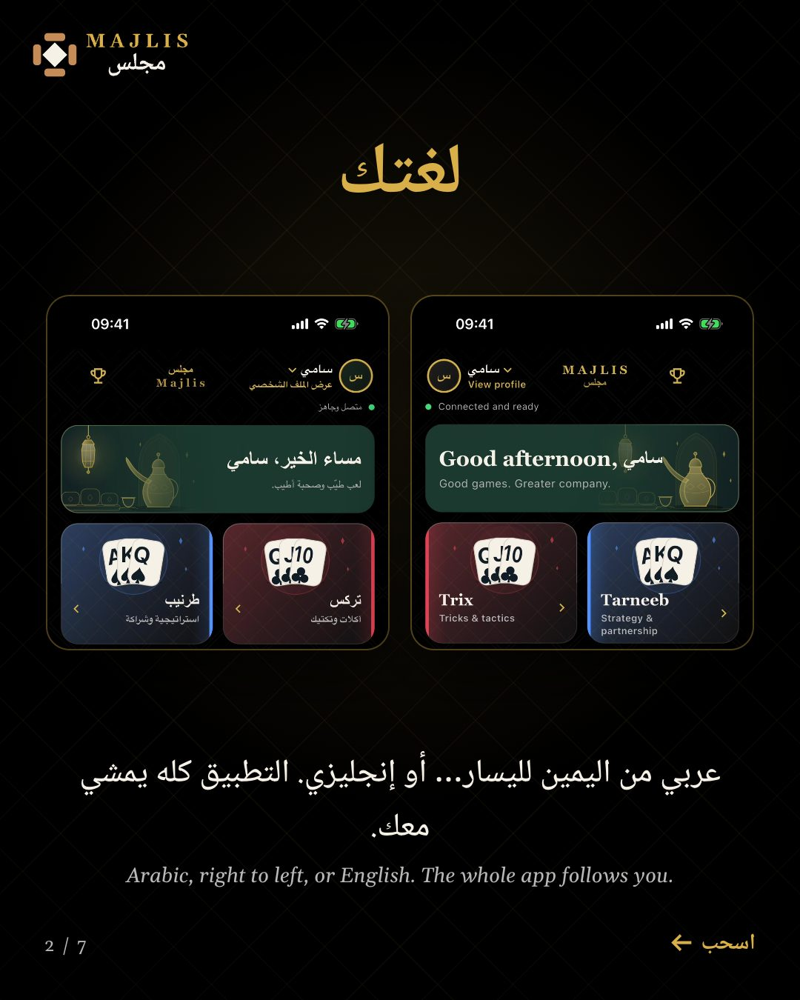
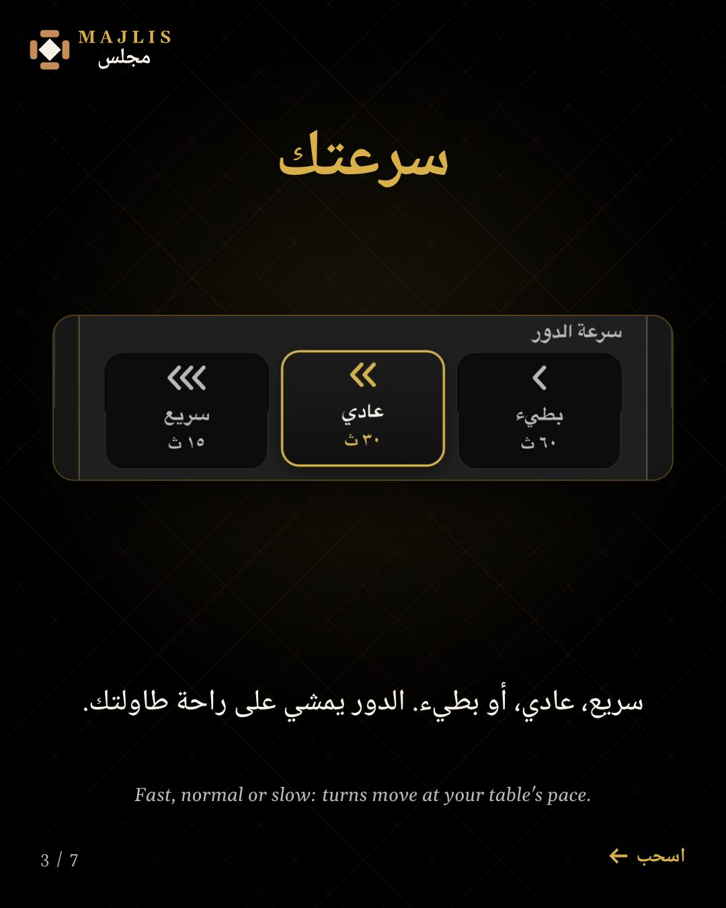
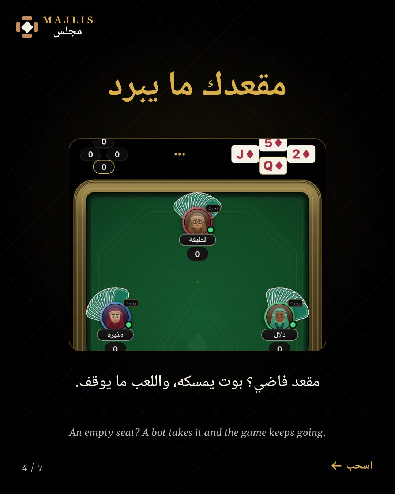
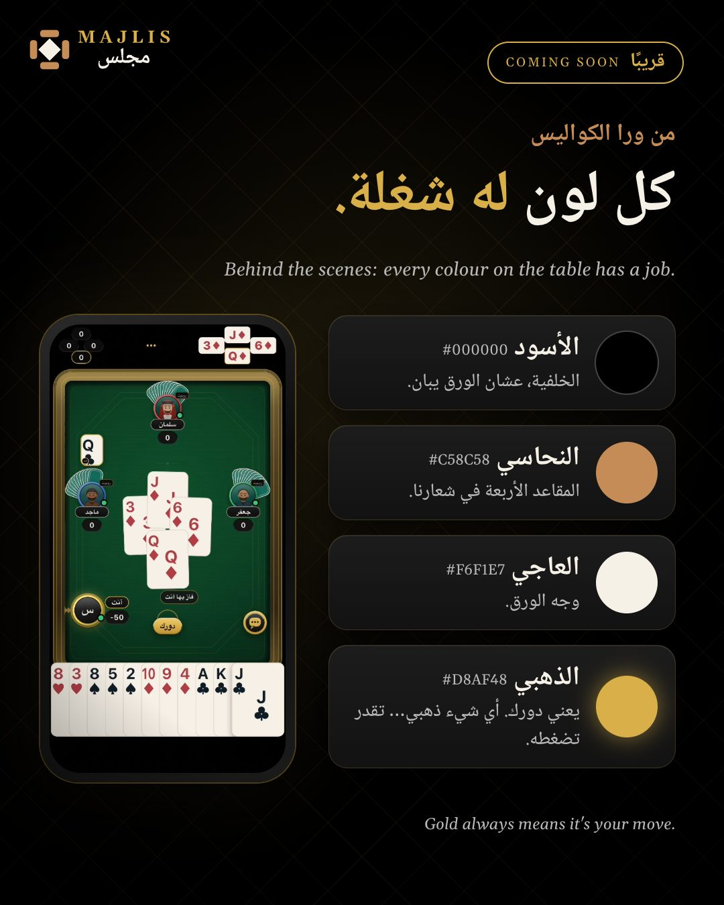

## Features

**At the table**
- **Three games:** Tarneeb (طرنيب), Trix (تركس) and 400 (أربعمية), with bidding, trump selection, Trix contracts and doubling.
- **Play your way:** a private table with friends, a public table with new players, or solo against bots.
- **Bots fill empty seats** so a game never waits.
- **Offline play** for solo tables.
- **Turn speed** per table (fast, normal, slow).
- **A table that feels real:** a single fanned hand, drag or double-tap to play, card sounds, haptics, an Arabic voice announcer, and set-piece moments such as the King of Hearts shockwave.

**Social**
- Friends, table chat with quick messages and emoji reactions, profile photos, points and levels.

**Built for Arabic speakers first**
- Arabic right-to-left by default, with a full English mode.
- A rich, tactile table design: bevels, gloss and a felt with depth.

## Status

Majlis is made for **Android and iOS**. For the latest, visit **https://majlis-game.com**.

## Contact

Made by Ahmad, published by **Majlis Games**.
Questions: **support@majlis-game.com**

---

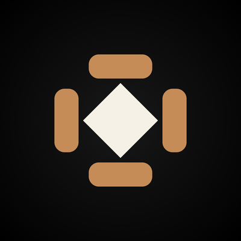 
This repository is a showcase. 
© 2026 Majlis Games. All rights reserved. Majlis, مجلس and the Majlis logo are brands of Majlis Games.

